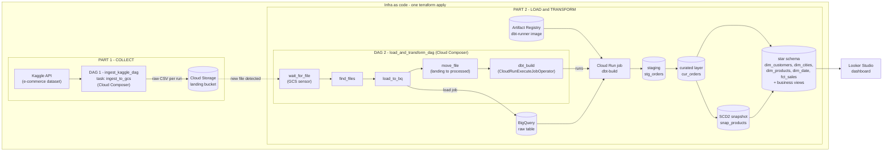

# Ecommerce GCP Analytics

End-to-end data engineering capstone project for ingesting Amazon sales data, loading it into BigQuery, transforming it with dbt, and exposing business metrics through Looker Studio.

## 🏗️ Architecture



The platform follows a layered architecture:

1. **Collect**: Kaggle API downloads the Amazon sales dataset.
2. **Landing**: the ingestion process uploads timestamped CSV files to the GCS `raw/` prefix.
3. **Orchestrate**: Cloud Composer runs the Airflow DAGs.
4. **Load**: raw CSV files are loaded into BigQuery.
5. **Transform**: a Cloud Run Job executes the dbt container.
6. **Serve**: dbt creates curated tables, dimensions, facts, snapshots, and business views in BigQuery.
7. **Visualize**: Looker Studio consumes the curated BigQuery layer.

## 📌 Project Description

The project implements a production-oriented batch pipeline:

```text
Kaggle API
    ↓
Cloud Composer / Airflow ingestion DAG
    ↓
Cloud Storage landing bucket (raw/)
    ↓
Cloud Composer / Airflow loading DAG
    ↓
BigQuery raw_ecommerce.amazon_sales
    ↓
Cloud Run Job: dbt-build
    ↓
BigQuery dbt_dev models and views
    ↓
Looker Studio dashboards
```

After a successful BigQuery load, the source objects are moved from `raw/` to `processed/`. The dbt job then builds the analytical layer.

## 🧰 Technical Stack

| Service / tool | Role |
| --- | --- |
| **Google Cloud Storage** | Landing zone for raw and processed CSV files |
| **Cloud Composer** | Managed Airflow orchestration |
| **Apache Airflow** | Schedules and coordinates ingestion, loading, and dbt execution |
| **BigQuery** | Stores the raw table and analytical models |
| **Cloud Run Jobs** | Runs dbt in an isolated, immutable Docker image |
| **Artifact Registry** | Stores the dbt Docker image |
| **Cloud Build** | Builds and pushes the dbt image |
| **Terraform** | Provisions GCP infrastructure and IAM configuration |
| **dbt** | Applies SQL transformations, tests, snapshots, and documentation |
| **Kaggle API / kagglehub** | Provides the source Amazon sales dataset |
| **Looker Studio** | Presents business dashboards |
| **Docker** | Supports local Airflow and the dbt image build |
| **PostgreSQL / Adminer** | Local dbt development and validation environment |

## 📁 Project Structure

```text
.
├── dags/
│   ├── dag_ingestion.py       # Kaggle → GCS
│   ├── dag_load.py            # GCS → BigQuery → Cloud Run dbt
│                # Python ingestion and BigQuery helpers
├── dbt/
│   ├── Dockerfile              # Immutable dbt runtime image
│   ├── dbt_project.yml
│   ├── profiles.yml
│   ├── packages.yml
│   ├── models/
│   │   ├── staging/
│   │   ├── macros/           # stg_orders and BigQuery source
│   │   └── marts/              # dimensions, fact, and business views
│   ├── snapshots/              # Product SCD2 snapshot
│   ├── tests/                  # Singular SQL tests
│   └── macros/
├── terraform/
│   ├── main.tf                 # GCP resources and IAM
│   ├── variables.tf
│   ├── versions.tf
│   ├── outputs.tf
│   └── terraform.tfvars.example
├── functions/
├── Implementation Gallery/     # Architecture and execution screenshots
├── .gitignore
├── .env            
├── requirements.txt
└── README.md
```

## 🌬️ Airflow DAGs

### `ecommerce_ingestion_dag`

Downloads `Amazon.csv` from Kaggle and uploads a timestamped object to the configured GCS bucket under `raw/`.


### `ecommerce_loading_dag`

Runs the following chain:

```text
wait_for_file
→ find_pending_files
→ load_to_bq
→ move_to_processed
→ dbt_build
```

The GCS sensor checks the `raw/` prefix every two minutes using reschedule mode. `dbt_build` triggers the Cloud Run Job instead of installing dbt inside Composer.


## 🧱 Data Model

The raw BigQuery table is:

```text
PROJECT_ID.raw_ecommerce.amazon_sales
```

The dbt analytical dataset is:

```text
PROJECT_ID.dbt_dev
```

### Staging

- `stg_orders`: renames raw columns to `snake_case` and applies types.

### Snapshot

- `snap_products`: SCD Type 2 history for product attributes.

### Dimensions

- `dim_customers`
- `dim_cities`
- `dim_products`
- `dim_date`

### Fact

- `fct_sales`: order-level sales fact with customer, city, product, and date keys.

### Business views

- `v_revenue_by_month_category_country`
- `v_top_products`
- `v_top_customers`
- `v_payment_method_share`
- `v_order_status_rate`

The project includes uniqueness, not-null, relationship, accepted-values, and singular SQL tests, including a consistency check for `total_amount`.


## 📊 Business Intelligence

Looker Studio connects to the curated tables and views in `PROJECT_ID.dbt_dev`. The dashboard can answer questions such as:

- Which categories and countries generate the most revenue?
- Which products and customers are top performers?
- What is the distribution of payment methods?
- What is the order-status rate?


## 🚀 Installation and Deployment

### Prerequisites

- A Google Cloud project, including a free-trial project if eligible.
- Billing enabled for services such as Composer, Cloud Run, BigQuery, and Cloud Build.
- Google Cloud SDK (`gcloud`) installed and authenticated.
- Terraform installed.
- Docker installed for local development and image builds.
- PowerShell or Google Cloud Shell.
- A Kaggle API token.

Authenticate locally:

```powershell
gcloud auth login
gcloud auth application-default login
gcloud config set project YOUR_PROJECT_ID
```

### Configure Terraform

Copy the example variables and provide values locally:

```text
terraform/terraform.tfvars
```

Do not commit this file or the Kaggle token.

From the Terraform directory:

```powershell
cd terraform
terraform init
terraform fmt
terraform validate
terraform plan
```

Terraform provisions the APIs, service accounts, IAM bindings, landing bucket, BigQuery datasets, Artifact Registry, Composer, Cloud Run Job, and Composer DAG objects.

### Build the dbt image

The dbt image must be built after Artifact Registry exists and before Terraform creates the Cloud Run Job. Use this sequence:

1. Create the Artifact Registry repository with a targeted Terraform apply:

```powershell
terraform apply -target=google_artifact_registry_repository.dbt
```

1. From the repository root, build and push the image:

```powershell
cd ..
gcloud builds submit dbt `
  --tag REGION-docker.pkg.dev/PROJECT_ID/ecommerce-dbt/dbt:latest
```

1. Return to the Terraform directory and create or update the remaining resources:

```powershell
cd terraform
terraform apply
```

The Google Terraform provider does not expose a native `google_cloudbuild_v1_build` resource in this configuration, so the `gcloud builds submit` command is intentionally kept as a separate build step.

### Start the pipeline

After Composer is `Running` and Airflow has imported the DAGs:

1. Trigger `ecommerce_ingestion_dag`.
2. Confirm a file appears under `gs://BUCKET/raw/`.
3. Trigger `ecommerce_loading_dag`.
4. Confirm the BigQuery load succeeds.
5. Confirm the object is moved to `processed/`.
6. Confirm the Cloud Run `dbt-build` job succeeds.
7. Confirm the models exist in `PROJECT_ID.dbt_dev`.
8. Connect Looker Studio to the curated tables or views.

## 🛠️ Troubleshooting

| Problem | Solution |
| --- | --- |
| `ModuleNotFoundError: No module named 'functions'` | Upload `functions/` under the Composer `dags/` prefix and keep the import path consistent. |
| GCS sensor finds no file | Check `GCS_BUCKET`, `GCS_OBJECT_PREFIX`, credentials, and that the object is under `raw/`. |
| BigQuery permission denied | Give the runtime service account BigQuery Job User and the required dataset-level viewer/editor roles. |
| `gcloud` permission error in dbt | Do not use a local `gcloud` credential inside Cloud Run; use the Cloud Run Job service account with dbt `method: oauth`. |
| dbt source not found | The `source()` name must match `_sources.yml`; `raw` is the dbt source name and `raw_ecommerce` is the BigQuery dataset. |
| Duplicate `fct_sales.order_id` | Check dimension joins, especially product joins, so one order does not match multiple dimension rows. |
| `click` / dbt dependency conflict in Composer | Keep dbt out of Composer and run it in the pinned Cloud Run image. |
| Cloud Build cannot read its temporary bucket | Grant the Cloud Build service account object read access to the Cloud Build source bucket through Terraform. |
| Cloud Run Job image not found | Build and push the image to the exact Artifact Registry URI used by Terraform before applying the Cloud Run Job. |
| `packages.yml` semantic-version error | Use an exact dbt package version, for example `dbt_utils` `1.3.2`. |

## 🔭 Future Improvements

- Add CI/CD with GitHub Actions or Cloud Build triggers.
- Run Terraform plan and dbt tests automatically on pull requests.
- Use Secret Manager or Composer secret backends instead of plain environment variables for sensitive tokens.
- Add data-quality monitoring and alerting.
- Add source freshness checks and observability dashboards.
- Replace manual Cloud Build execution with a dedicated CI/CD pipeline.

## 📬 Contact

- **Linkedin:** [Profile](https://www.linkedin.com/in/oussama-inchallah/)

- **Email:** <oussamainchallah1@gmail.com>
